# Diseño de clases UML de ScanTrue

El diagrama describe las clases, módulos y contratos de la aplicación ejecutable: API FastAPI, servicios, persistencia, clasificadores, registro blockchain y contratos de datos. Las rutas y los módulos de la extensión se representan como módulos con sus funciones públicas; no son clases del código fuente. Se excluyen los scripts experimentales y de entrenamiento de `bilstm/` y `mBERT/`: son herramientas de investigación independientes, no parte del flujo de ejecución de la aplicación.

```mermaid
classDiagram
direction LR

class AppModule {
  <<module>>
  +lifespan(app)
}
class AnalysisRoutes {
  <<module>>
  +health(request)
  +analyze(payload, request, token)
}
class IdentityRoutes {
  <<module>>
  +create_guest()
  +register(credentials, guest_token)
  +login(credentials, guest_token)
  +refresh(payload)
  +close_session(token)
}
class HistoryRoutes {
  <<module>>
  +list_history(limit, offset, token)
  +get_history_item(analysis_id, token)
  +delete_history_item(analysis_id, token)
}
class MetricsRoutes {
  <<module>>
  +get_metrics(modelo)
}
class BlockchainRoutes {
  <<module>>
  +verify_analysis(analysis_id, token)
}
class Dependencies {
  <<module>>
  +bearer_token(authorization)
  +identity_service(request)
  +history_repository(request)
}

class AnalysisService {
  +predictor: BilstmPredictor
  +mbert_predictor: Predictor | None
  +mbert_text_policy: MbertTokenizer | None
  +mbert_weight: float
  +analyze(payload) AnalysisOutcome
  -_bilstm_prefix(text) tuple~str, bool~
}
class Predictor {
  <<interface>>
  +predict(text) dict
}
class AnalysisOutcome {
  +response: AnalysisResponse
  +text: str
  +truncated: bool
}
class IdentityService {
  +settings: SupabaseSettings
  +repository: SupabaseRepository
  +verify_user(token)
  +create_guest() SessionResponse
  +register(guest_token, credentials) RegistrationResponse
  +login(credentials, guest_token) LoginResponse
  +refresh(refresh_token) SessionResponse
  +close_session(access_token)
  -_client()
  -_session(auth_response) SessionResponse
}
class SupabaseRepository {
  +settings: SupabaseSettings
  -_request(method, path, token, admin, params, body, prefer)
  +create_analysis(user_id, url, text, text_hash, response) UUID
  +list_analysis(token, user_id, limit, offset) HistoryListRecord[]
  +get_analysis(token, user_id, analysis_id) HistoryRecord | None
  +delete_analysis(token, user_id, analysis_id) bool
  +transfer_guest_history(guest_id, account_id) int
  +claim_blockchain_analysis() UUID | None
  +get_blockchain_analysis(analysis_id) HistoryRecord | None
  +set_blockchain_state(analysis_id, state, transaction_hash, next_attempt, error)
}

class BilstmPredictor {
  +checkpoint: Path
  +model
  +vocab
  +max_len: int
  +device
  +version: str
  +predict(text) dict
  +tokenize(text) str[]
}
class MbertTokenizer {
  +model_dir: Path
  +tokenizer_dir: Path
  +version: str
  +max_len: int
  +fake_threshold: float
  +prepare(text) tuple~str, bool, int~
}
class MbertPredictor {
  +text_policy: MbertTokenizer
  +model
  +device
  +version: str
  +predict(text) dict
}
class AnalysisSettings {
  +mbert_weight: float
  +from_environment() AnalysisSettings
}
class SupabaseSettings {
  +url: str
  +publishable_key: str
  +secret_key: str | None
  +from_environment() SupabaseSettings | None
}
class BlockchainSettings {
  +rpc_url: str
  +chain_id: int
  +private_key: str
  +contract_address: str
  +contract_abi: dict[]
  +deployment_block: int
  +deployment_block_hash: str
  +from_environment() BlockchainSettings | None
}
class RegistryClient {
  +settings: BlockchainSettings
  -web3
  -contract
  +check_ready()
  +find_registration(analysis_id) str | None
  +send(record) str
  +verify(record, transaction_hash) bool | None
}
class BlockchainWorker {
  +repository: SupabaseRepository
  +client: RegistryClient
  +process_one() bool
  +run()
  -_failed(analysis_id, transaction_hash, reason, now)
}

class AnalysisRequest {
  +texto: str
  +url: str | None
}
class ModelResult {
  +modelo: str
  +estado: str
  +version: str | None
  +clase: str | None
  +probabilidad_falsa: float | None
  +tokens_leidos: int | None
  +error: str | None
}
class AppliedWeights {
  +bilstm: float
  +mbert: float
}
class UnifiedResult {
  +probabilidad_falsa: float
  +modelos_utilizados: str[]
  +pesos_aplicados: AppliedWeights
  +version_regla: str
}
class AnalysisResponse {
  +resultados: dict~str, ModelResult~
  +resultado_unificado: UnifiedResult
  +comparacion: str
  +nota: str
}
class CreatedAnalysis {
  +id: UUID
  +estado_blockchain: str
  +texto_recortado: bool
}
class HistoryBase {
  +id: UUID
  +fecha: datetime
  +url: str | None
  +hash_texto: str
  +comparacion: str
  +estado_blockchain: str
  +hash_transaccion: str | None
  +resultados: dict~str, ModelResult~
  +resultado_unificado: UnifiedResult | None
}
class HistoryListRecord {
  +vista_previa: str | None
}
class HistoryRecord {
  +texto: str | None
}
class VerificationResponse {
  +estado_blockchain: str
  +hash_transaccion: str | None
  +verificado: bool | None
  +detalle: str
}
class Credentials {
  +correo: str
  +contrasena: SecretStr
}
class RefreshRequest {
  +refresh_token: SecretStr
}
class SessionResponse {
  +usuario_id: UUID
  +anonimo: bool
  +access_token: str
  +refresh_token: str
  +expires_in: int
}
class RegistrationResponse {
  +estado: str
  +sesion: SessionResponse | None
  +registros_incorporados: int
}
class LoginResponse {
  +sesion: SessionResponse
  +registros_incorporados: int
}
class ModelEvaluation {
  +conjunto: str
  +n: int
  +matriz_confusion: int[][]
  +exactitud: float
  +precision_falsa: float
  +recall_falsa: float
  +f1_falsa: float
  +f1_macro: float
  +fuente: str
}
class MetricsResponse {
  +modelo: str
  +version: str
  +orden_clases: str[]
  +evaluaciones: ModelEvaluation[]
  +limitaciones: str[]
}

class AnalysisExtension {
  <<module>>
  +startAnalysis()
  +getAnalysisOperation()
  +clearCompletedAnalysis()
  +ensureSession()
  +renewSession(session)
}
class AccountExtension {
  <<module>>
  +registerAccount(email, password)
  +loginAccount(email, password, skipGuestTransfer)
  +getAccountState()
  +closeAccountSession()
}
class HistoryExtension {
  <<module>>
  +listHistory(offset)
  +getHistoryDetail(id)
  +deleteHistoryDetail(id)
}
class MetricsExtension {
  <<module>>
  +getPublishedMetrics(model)
}

AppModule --> AnalysisRoutes : registra
AppModule --> IdentityRoutes : registra
AppModule --> HistoryRoutes : registra
AppModule --> MetricsRoutes : registra
AppModule --> BlockchainRoutes : registra
AppModule --> AnalysisService : inicializa
AppModule --> AnalysisSettings : lee configuración
AppModule --> IdentityService : inicializa
AppModule --> SupabaseRepository : inicializa
AppModule --> RegistryClient : inicializa
AppModule --> BlockchainWorker : inicia tarea
AnalysisRoutes ..> Dependencies
IdentityRoutes ..> Dependencies
HistoryRoutes ..> Dependencies
BlockchainRoutes ..> Dependencies
AnalysisRoutes --> AnalysisService
AnalysisRoutes --> IdentityService
AnalysisRoutes --> SupabaseRepository
IdentityRoutes --> IdentityService
HistoryRoutes --> IdentityService
HistoryRoutes --> SupabaseRepository
BlockchainRoutes --> IdentityService
BlockchainRoutes --> SupabaseRepository
BlockchainRoutes --> RegistryClient
AnalysisService --> Predictor
AnalysisService ..> AnalysisOutcome : crea
AnalysisOutcome *-- AnalysisResponse : response
AnalysisService ..> AnalysisRequest
AnalysisService ..> AnalysisResponse
BilstmPredictor ..|> Predictor
MbertPredictor ..|> Predictor
MbertPredictor --> MbertTokenizer
AnalysisService --> BilstmPredictor
AnalysisService --> MbertPredictor
IdentityService --> SupabaseSettings
IdentityService --> SupabaseRepository
SupabaseRepository --> SupabaseSettings
RegistryClient --> BlockchainSettings
BlockchainWorker --> SupabaseRepository
BlockchainWorker --> RegistryClient
AnalysisRoutes ..> CreatedAnalysis
AnalysisResponse *-- ModelResult
AnalysisResponse *-- UnifiedResult
UnifiedResult *-- AppliedWeights
CreatedAnalysis --|> AnalysisResponse
HistoryBase *-- ModelResult
HistoryBase "1" *-- "0..1" UnifiedResult : resultado_unificado
HistoryListRecord --|> HistoryBase
HistoryRecord --|> HistoryBase
HistoryRoutes ..> HistoryListRecord
HistoryRoutes ..> HistoryRecord
BlockchainRoutes ..> VerificationResponse
IdentityRoutes ..> Credentials
IdentityRoutes ..> RefreshRequest
IdentityService ..> SessionResponse
IdentityService ..> RegistrationResponse
IdentityService ..> LoginResponse
RegistrationResponse "1" *-- "0..1" SessionResponse : sesion
LoginResponse "1" *-- "1" SessionResponse : sesion
MetricsRoutes ..> MetricsResponse
MetricsResponse *-- ModelEvaluation
AccountExtension ..> AnalysisExtension : importa sesión y operación
HistoryExtension ..> AnalysisExtension : importa sesión
MetricsExtension ..> MetricsResponse : consume API
AnalysisExtension ..> CreatedAnalysis : consume API
HistoryExtension ..> HistoryRecord : consume API
HistoryExtension ..> HistoryListRecord : consume API
AccountExtension ..> SessionResponse : consume API
```

## Lectura de relaciones

- `*--` indica composición; `--|>` herencia; `..|>` realización de una interfaz; `-->` asociación y `..>` dependencia. Las multiplicidades indican si una respuesta puede omitir una sesión.
- Los esquemas de Pydantic representan los contratos HTTP. Los campos opcionales pueden llegar como `null`; sus restricciones exactas viven en los esquemas fuente.
- `AnalysisService` combina los resultados disponibles y puede continuar con un solo predictor si el otro falla. El `AnalysisOutcome` mantiene el texto efectivamente analizado y si fue recortado.
- `SupabaseRepository` consulta y elimina el historial con el token del usuario. La creación, la transferencia del historial invitado y las tareas blockchain usan operaciones privilegiadas después de las comprobaciones correspondientes en el backend.
- La extensión consume la API local. Sus módulos guardan estado de sesión y operación en `chrome.storage`; no son entidades persistidas del backend.

## Fuentes del diseño

El diagrama refleja `backend/app.py`, `backend/api/`, `backend/services/`, `backend/models/`, `backend/repositories/`, `backend/blockchain/`, `backend/core/config.py`, `backend/schemas/` y `frontend/src/extension/`.
