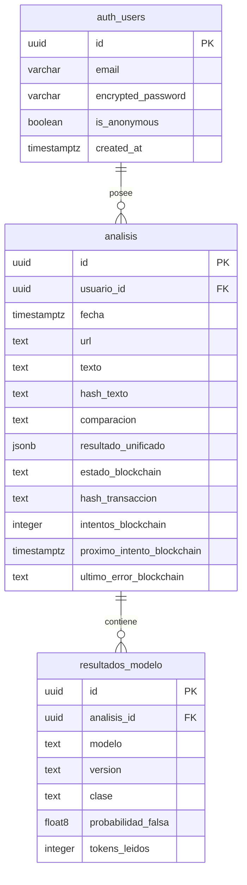

# Diseño físico de la base de datos de ScanTrue

Este documento representa el esquema PostgreSQL de ScanTrue **después de aplicar, en orden, las migraciones 001 a 005** de `backend/db/migrations/`. Describe las tablas propias de la aplicación en `public` y su vínculo con `auth.users`, administrada por Supabase Auth. No representa estados intermedios de las migraciones ni propone cambios al esquema.

El detalle de cada campo en el formato solicitado está en el [diccionario de datos](./DICCIONARIO_DATOS_SCANTRUE.md).

## Diagrama entidad–relación

`auth_users` representa cinco campos relevantes de `auth.users`. Supabase administra esa tabla; ScanTrue solo referencia su `id`. `float8` es el alias PostgreSQL de `double precision`. La base permite cero resultados relacionados durante una transacción; la función de creación exige **uno o dos** y la restricción `UNIQUE (analisis_id, modelo)` limita a uno por cada modelo permitido (`bilstm` y `mbert`).

## Referencia a Supabase Auth

`auth.users` guarda el identificador, el correo, un hash de contraseña cuando se usa ese método de acceso, si el usuario es anónimo y cuándo fue creado. `email` y `encrypted_password` pueden ser nulos. Supabase administra las demás columnas y las sesiones. La relación física de ScanTrue es `public.analisis.usuario_id → auth.users.id`; las políticas RLS comparan ese identificador con `auth.uid()`.

## Tabla `public.analisis`

| Columna | Tipo PostgreSQL | Nulos | Valor predeterminado | Restricción o uso |
| --- | --- | --- | --- | --- |
| `id` | `uuid` | No | `gen_random_uuid()` | Clave primaria. |
| `usuario_id` | `uuid` | No | — | FK a `auth.users(id)`; borrado en cascada. |
| `fecha` | `timestamptz` | No | `now()` | Fecha de creación; orden del historial. |
| `url` | `text` | Sí | — | Longitud máxima de 2048 caracteres cuando existe. |
| `texto` | `text` | Sí | — | Fragmento analizado. Es anulable para conservar registros anteriores a la migración 004; la función de creación actual exige texto no vacío. |
| `hash_texto` | `text` | No | — | 64 caracteres hexadecimales minúsculos (`^[0-9a-f]{64}$`). |
| `comparacion` | `text` | No | — | `coinciden`, `discrepan` o `no_disponible`. |
| `resultado_unificado` | `jsonb` | Sí | — | Si existe, debe ser un objeto JSON; la función de creación actual valida además su estructura y probabilidad. |
| `estado_blockchain` | `text` | No | `pendiente` | `no_iniciado`, `pendiente`, `confirmado` o `fallido`. |
| `hash_transaccion` | `text` | Sí | — | Si existe, coincide con `^0x[0-9a-fA-F]{64}$`. |
| `intentos_blockchain` | `integer` | No | `0` | Número de reclamos; no puede ser negativo. |
| `proximo_intento_blockchain` | `timestamptz` | No | `now()` | Momento desde el cual el trabajador puede reclamar la fila. |
| `ultimo_error_blockchain` | `text` | Sí | — | Último motivo de fallo del registro. |

La columna `titulo` existía en la migración inicial, pero **se eliminó en la 005**. El fragmento efectivamente analizado se guarda en Supabase; el registro de Anvil usa datos canónicos derivados del análisis.

## Tabla `public.resultados_modelo`

| Columna | Tipo PostgreSQL | Nulos | Valor predeterminado | Restricción o uso |
| --- | --- | --- | --- | --- |
| `id` | `uuid` | No | `gen_random_uuid()` | Clave primaria. |
| `analisis_id` | `uuid` | No | — | FK a `public.analisis(id)`; borrado en cascada. |
| `modelo` | `text` | No | — | `bilstm` o `mbert`; único por análisis junto con `analisis_id`. |
| `version` | `text` | No | — | Entre 1 y 160 caracteres. |
| `clase` | `text` | No | — | `falsa` o `real`. |
| `probabilidad_falsa` | `double precision` | No | — | Entre 0 y 1, inclusive. |
| `tokens_leidos` | `integer` | No | — | Mayor que cero. |

## Claves e índices

| Objeto | Definición | Finalidad |
| --- | --- | --- |
| PK de `analisis` | `PRIMARY KEY (id)` | Identificación del análisis. |
| PK de `resultados_modelo` | `PRIMARY KEY (id)` | Identificación de la predicción. |
| FK `analisis.usuario_id` | `REFERENCES auth.users(id) ON DELETE CASCADE` | Eliminar el historial al eliminar el usuario. |
| FK `resultados_modelo.analisis_id` | `REFERENCES public.analisis(id) ON DELETE CASCADE` | Eliminar las predicciones al eliminar el análisis. |
| Unicidad de resultados | `UNIQUE (analisis_id, modelo)` | Impedir predicciones duplicadas del mismo modelo en un análisis; PostgreSQL crea su índice único. |
| `analisis_usuario_fecha_idx` | `(usuario_id, fecha DESC, id DESC)` | Listar el historial de un usuario en orden descendente. |
| `resultados_modelo_analisis_idx` | `(analisis_id)` | Consultar las predicciones de un análisis. |
| `analisis_blockchain_cola_idx` | `(proximo_intento_blockchain, id) WHERE estado_blockchain IN ('pendiente', 'fallido')` | Buscar los siguientes registros reclamables. |

## Acceso y políticas RLS

Ambas tablas tienen Row Level Security habilitada. Tras la migración 002, `authenticated` conserva `SELECT` y `DELETE` sobre `analisis`, y `SELECT` sobre `resultados_modelo`; no tiene `INSERT` directo en ninguna de las dos. No se conceden privilegios de tabla a `anon` en estas migraciones. Los invitados de Supabase Auth usan el rol `authenticated` con su propio `auth.uid()`.

| Política vigente | Tabla y operación | Condición |
| --- | --- | --- |
| `analisis_leer_propio` | `analisis` · `SELECT` | `usuario_id = (select auth.uid())` |
| `analisis_eliminar_propio` | `analisis` · `DELETE` | `usuario_id = (select auth.uid())` |
| `resultados_leer_propios` | `resultados_modelo` · `SELECT` | Existe el análisis padre y su `usuario_id` coincide con `(select auth.uid())`. |

La API verifica el token antes de crear un análisis y llama con su clave secreta a `public.crear_analisis_texto_unico(...)`, ejecutable por `service_role`. Esa función inserta el análisis y sus predicciones en una sola transacción. `public.reclamar_registro_blockchain()` también está reservada a `service_role`; selecciona una fila vencida con `FOR UPDATE SKIP LOCKED`, incrementa `intentos_blockchain` y reserva 60 segundos. El trabajador actualiza después el estado de blockchain. Las funciones de creación anteriores se eliminaron en la migración 005.

## Alcance y fuentes

- **Supabase Auth:** `auth.users` aporta la identidad; ScanTrue no crea una tabla propia de usuarios o sesiones.
- **Blockchain:** el contrato en Anvil es un almacén externo, no una tabla PostgreSQL. Sus campos de conciliación sí están en `public.analisis`.
- **Estado documentado:** esquema resultante de `backend/db/migrations/001_identity_history.sql` a `005_texto_unico.sql`; operaciones contrastadas con `backend/repositories/supabase.py` y `backend/blockchain/worker.py`.
