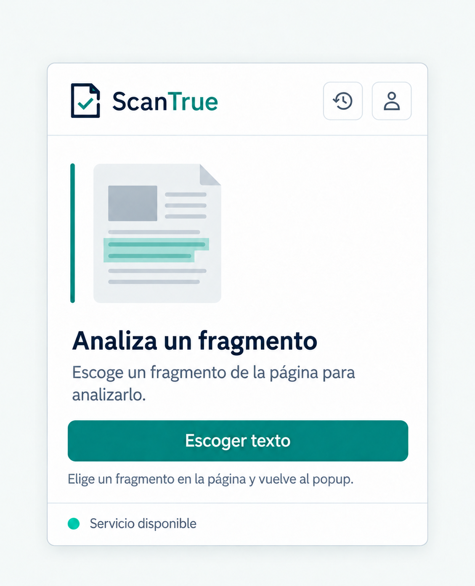

# P01 Inicio y estado del servicio

## Estado de este archivo

Planificación de la primera pantalla del paso 2. La imagen `referencias/p01-concepto-v2.png` es una referencia visual para orientar el diseño, no una especificación exacta de píxeles. P01 ya tiene una primera implementación dentro de `frontend/`: vista inicial, navegación interna, consulta a `/salud` e inicio de selección en la pestaña activa. La presentación y acciones completas del fragmento capturado corresponden a P02. La revisión interactiva en Chrome sigue pendiente.

## Objetivo de P01

Dar al usuario un punto de inicio claro dentro del popup: entender qué puede hacer ScanTrue, comprobar si el servicio local está disponible y comenzar la selección del texto que quiere analizar. Desde aquí también puede abrir historial, cuenta y métricas, todos como vistas del mismo popup.

## Entradas y salidas

| Situación al abrir el popup | Vista o acción esperada |
| --- | --- |
| No hay texto pendiente | Mostrar P01. |
| Hay texto seleccionado pendiente | Mostrar P02 con ese texto, sin perderlo ni enviarlo automáticamente. |
| El estado de la API aún se consulta | Mostrar un estado breve de comprobación sin bloquear la navegación que no requiera API. |
| API disponible o degradada | Mostrar el estado recibido por `/salud` con una etiqueta comprensible. |
| API inaccesible | Explicar que la API local debe estar encendida; permitir reintentar la consulta. |

P01 no crea un análisis. Tampoco muestra un porcentaje, clasificación o métrica no recibida de la API.

## Jerarquía de contenido

1. **Cabecera:** símbolo y nombre ScanTrue; accesos a Historial y Cuenta; cierre del popup si se mantiene el control de cerrar en la cabecera común.
2. **Área principal:** ilustración documental muy simple y título **Analiza un fragmento**.
3. **Explicación:** “Escoge un fragmento de la página para analizarlo.”
4. **Acción principal:** botón **Escoger texto**.
5. **Ayuda inmediata:** “Elige un fragmento en la página y vuelve al popup.” No mostrar atajos de teclado no implementados.
6. **Pie funcional:** estado del servicio y acceso discreto a **Métricas de modelos**.

Esta jerarquía conserva la claridad de la imagen de concepto, pero el pie y las acciones se ajustarán al contenido real y al espacio del popup. P01 y cada pantalla posterior seguirán `SISTEMA_DISENO.md`: fondo claro, texto azul profundo, acento verde azulado, línea lateral de selección y una sola acción primaria. Los nombres de los modelos se reservan para las vistas donde se presentan sus resultados.

## Acciones y navegación

| Acción | Respuesta de P01 |
| --- | --- |
| **Escoger texto** | Iniciar el flujo de selección en la pestaña activa. El popup puede cerrarse mientras el usuario interactúa con la página. Cuando se capture texto, conservarlo temporalmente y mostrarlo en P02 al reabrir el popup. |
| **Historial** | Abrir P07 dentro del popup. Si se requiere sesión o la API falla, mostrar el estado correspondiente allí. |
| **Cuenta** | Abrir P11 dentro del popup. |
| **Métricas de modelos** | Abrir P09 dentro del popup. |
| **Reintentar estado** | Consultar nuevamente `/salud` cuando la API no responda o el estado sea incierto. |
| **Cerrar** | Cerrar solo el popup; no cerrar la sesión del usuario. |

El recorrido de selección aprobado por el usuario es: **Escoger texto → seleccionar en la página → mostrar el fragmento en P02 → Analizar o Seleccionar de nuevo**. P01 inicia ese recorrido; el diseño y la implementación de P02 se detallarán en su propio archivo cuando llegue su turno.

## Estados visibles de P01

| Estado | Presentación |
| --- | --- |
| Inicial | Título, explicación y **Escoger texto**. |
| Comprobando servicio | Mensaje breve “Comprobando servicio…” en el pie, sin indicador llamativo. |
| Servicio disponible | Etiqueta “Servicio disponible” solo cuando la API lo confirme. |
| Servicio degradado | Etiqueta “Servicio parcialmente disponible” y explicación breve si la API ofrece detalle. |
| Servicio inaccesible | “La API local no responde. Enciéndela en este equipo y vuelve a intentarlo.” Acción **Reintentar**. |
| No se puede seleccionar en la pestaña actual | Mensaje que explique que esa página no permite la captura y sugiera probar una página web compatible. No simular una selección. |
| Hay selección pendiente | P01 cede el lugar a P02; no oculta el texto capturado. |

El estado visual no depende solo de color. El indicador de disponibilidad se basa en la respuesta real de `/salud`, nunca en un valor fijo de la maqueta.

## Especificación visual de referencia

- Ancho objetivo de diseño: alrededor de 400 px; el contenido debe seguir siendo legible si el espacio visible varía.
- Margen lateral de 20 px, cabecera compacta, área principal alineada a la izquierda y botón primario de ancho completo.
- Ilustración documental sencilla y sin datos falsos; no debe desplazar el botón principal fuera de la primera vista.
- El pie de servicio es discreto. El acceso a métricas puede mostrarse como enlace de texto, sin competir con **Escoger texto**.
- Los iconos tendrán nombres accesibles y foco visible. No usar solo un reloj ambiguo para Historial sin etiqueta accesible.
- Evitar “verificar noticia” como promesa y evitar lenguaje de certeza factual.

## Plan de implementación posterior

1. Crear la estructura React de P01 y sus estilos Tailwind dentro del popup, reutilizando los tokens de `SISTEMA_DISENO.md`.
2. Conectar la navegación interna a P07, P09 y P11 sin abrir pestañas ni páginas adicionales.
3. Conectar el indicador de servicio a `/salud` mediante el cliente REST común y presentar sus estados sin datos simulados en producción.
4. Conectar **Escoger texto** con el flujo del content script y el service worker, conservando el texto pendiente para P02. Esta conexión se completará y validará junto con P02.
5. Revisar teclado, foco, cierre del popup y legibilidad en el tamaño real de Chrome.

Estos puntos describen trabajo futuro; este archivo no implementa ninguno.

## Criterios de aceptación de P01

- P01 aparece cuando no existe texto pendiente; si existe, el usuario ve P02 con su selección.
- **Escoger texto** es la acción principal y no dispara un análisis ni una solicitud `POST /analisis`.
- Historial, Cuenta y Métricas abren vistas internas del popup.
- El estado del servicio se corresponde con `/salud` o indica claramente que no se pudo consultar.
- El contenido cabe y puede leerse en el popup sin cortar el botón principal.
- La cabecera, el foco de teclado y las etiquetas de iconos son comprensibles.
- No se usan expresiones que presenten la clasificación como verificación de hechos.

## Dependencias y límite

Para el indicador se necesita confirmar la respuesta vigente de `/salud`; esa dependencia ya pertenece a `DEPENDENCIAS_BACKEND.md`. La lógica completa de selección y presentación del fragmento se cerrará con P02. Después de revisar P01 en el popup se continuará con la siguiente pantalla, una por una.
