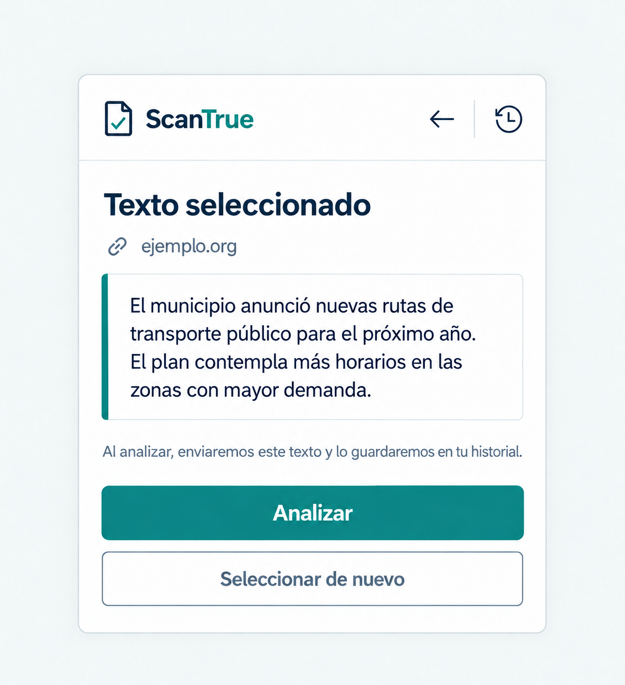

# P02 Texto seleccionado

## Estado de este archivo

Planificación de la segunda pantalla del paso 2. Usa `SISTEMA_DISENO.md` y sigue la dirección visual acordada para P01. La imagen siguiente es una referencia de composición con texto ilustrativo; la pantalla real muestra únicamente lo que el usuario haya seleccionado. P02 ya está implementada en `src/popup/App.jsx`, con selección persistida, nueva captura y envío explícito al análisis. La comprobación interactiva con la API real sigue pendiente.

## Objetivo de P02

Permitir que el usuario revise y edite el texto antes de enviarlo. Puede agregar otras selecciones de la página, pegar texto y borrar partes, y después decidir si pulsa **Analizar**.

## Entrada y salida

| Condición | Respuesta |
| --- | --- |
| Hay texto pendiente de la pestaña activa | Abrir P02 y mostrar el fragmento seleccionado. |
| El popup se cerró durante la selección | Conservar el fragmento y mostrarlo cuando el usuario vuelva a abrir el popup. |
| No se capturó texto o el usuario canceló | Volver a P01 o mostrar una indicación breve para escoger texto. |
| El usuario pulsa **Analizar** | Iniciar el análisis del fragmento y mostrar P04 mientras se espera la respuesta. |
| El usuario pulsa **Seleccionar nuevo texto** | Permitir otra selección. El fragmento nuevo se agrega al texto existente sin borrarlo. |
| El usuario escribe, pega o borra texto | Actualizar el borrador conservado en la sesión del navegador. |

## Contenido y jerarquía

1. Cabecera común de ScanTrue, con **Volver** y acceso a Historial si cabe sin distraer de la tarea.
2. Título breve: **Texto para analizar**, con el icono de **Volver** a su izquierda.
3. Origen de la selección: dominio de la página cuando exista una URL válida. Si no existe, se omite la fila de origen.
4. Texto completo en un campo editable con línea lateral verde azulada. Si es largo, el campo se desplaza sin ocultar las acciones.
5. Acción principal: **Analizar**.
6. Acción secundaria: **Seleccionar nuevo texto**.

No mostrar nombres de modelos, porcentajes, conteos de tokens ni lenguaje técnico en esta vista. El texto de la imagen es solo un ejemplo de maquetación; no se insertará como contenido predeterminado.

## Comportamiento de las acciones

| Acción | Resultado esperado |
| --- | --- |
| **Analizar** | Iniciar una sola solicitud de análisis y abrir P04 para mostrar el progreso. Evitar pulsaciones duplicadas. El texto no se envía antes de esta decisión. |
| **Seleccionar nuevo texto** | Volver a la página para elegir otro fragmento. Conservar el borrador y añadir la captura nueva al final; cancelar no borra el texto existente. |
| **Editar o pegar** | Permitir escribir, pegar y eliminar partes directamente en el campo. Analizar usa la última versión guardada. |
| **Volver** | Regresar a P01 sin perder el fragmento pendiente; al reabrir P02, seguir mostrándolo. |
| **Historial** | Abrir P07 dentro del popup, conservando temporalmente la selección para poder volver. |

## Estados que debe representar

| Estado | Presentación |
| --- | --- |
| Texto listo | Mostrar fragmento y ambas acciones. |
| Texto largo | Mostrarlo en un área de lectura desplazable, con principio y final accesibles. |
| Nueva selección en curso | Conservar el borrador mientras el usuario escoge más texto; al volver, mostrar ambos fragmentos. |
| Selección cancelada | Mantener el texto anterior si lo había; si no había ninguno, volver a P01. |
| Texto rechazado por la API | Conservar el borrador y ofrecer **Seleccionar nuevo texto**. Si falta longitud, mostrar “El texto es muy corto. Añade más contenido.” |
| Página incompatible con la captura | Explicar que no se pudo seleccionar texto en esa página y sugerir otra página compatible. |

La API decide si el texto cumple las reglas de longitud y legibilidad. La interfaz puede orientar, pero no reemplaza esa validación con un criterio propio que bloquee el envío.

## Aplicación del sistema de diseño

- Mantener paleta, tipografía, espaciado, radios, foco y cabecera definidos en `SISTEMA_DISENO.md`.
- Tratar el texto como un campo editable: fondo blanco, borde sutil, línea lateral de acento y texto alineado a la izquierda.
- Un único botón sólido para la acción principal; **Seleccionar nuevo texto** usa el tratamiento secundario.
- No añadir ilustraciones o tarjetas decorativas a P02: el texto elegido es el contenido principal.
- Mostrar el dominio como dato secundario, nunca como garantía de fiabilidad de la noticia.
- Las vistas y confirmaciones permanecen dentro del popup.

## Plan de implementación posterior

1. Construir la vista React de P02 con los elementos y estados anteriores, reutilizando los componentes y tokens de P01.
2. Leer la selección pendiente del almacenamiento temporal de la extensión y presentar el texto completo, incluso si el popup se cerró o el service worker se reinició.
3. Conectar **Seleccionar nuevo texto** con el flujo de captura iniciado desde P01. Añadir el fragmento nuevo al borrador sin perder lo editado o pegado.
4. Conectar **Analizar** directamente con el inicio de la solicitud y P04, evitando envíos duplicados y manteniendo la selección hasta que termine el flujo.
5. Comprobar el diseño con texto breve, texto largo, ausencia de URL, cancelación y error de validación.

La vista y el inicio de la solicitud ya están implementados. P04 y P05 tienen presentaciones provisionales para recibir el estado y el resultado; sus diseños y recorridos completos se desarrollarán en sus pasos respectivos.

## Criterios de aceptación de P02

- Muestra el texto escogido y los cambios que haga el usuario, sin sustituirlo por ejemplos ni añadir contenido de la página.
- El texto permanece disponible al cerrar y reabrir el popup durante la sesión del navegador.
- **Analizar** y **Seleccionar nuevo texto** son visibles y fáciles de distinguir.
- El usuario puede pegar texto, añadir otra captura y borrar cualquier parte antes de analizar.
- No se envía un análisis antes de que el usuario pulse **Analizar**; al pulsarlo, el flujo pasa directamente a P04.
- Volver o cancelar una nueva selección no borra el fragmento anterior sin confirmación.
- El texto largo puede leerse completo y las acciones siguen siendo alcanzables con teclado.
- No aparecen datos inventados, términos técnicos innecesarios ni afirmaciones de veracidad.

## Dependencias y siguiente pantalla

P02 depende de la captura iniciada en P01 y del almacenamiento temporal de la selección. El inicio de la solicitud ya se conecta con la API según `FRONTEND_CONTEXT.md`; el contrato real aún debe verificarse en Chrome con el backend encendido. P04 tiene su plan separado y es la siguiente pantalla por completar.
