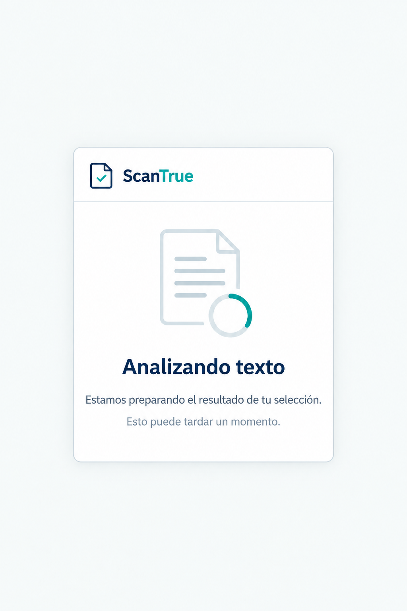

# P04 Análisis en curso

## Estado de este archivo

Planificación de la pantalla que sigue a P02. Al pulsar **Analizar** se inicia una sola solicitud y se muestra P04. Esta pantalla aplica `SISTEMA_DISENO.md`. La imagen siguiente representa el estado de espera, no los posibles errores. P04 ya está implementada en el popup; su integración con la API real aún debe comprobarse en Chrome.

## Objetivo de P04

Indicar que la selección se está analizando y mantener al usuario orientado hasta recibir una respuesta. P04 no debe fingir un avance medible ni permitir que se envíe la misma selección por segunda vez mientras la solicitud sigue pendiente.

## Entrada y destinos

| Situación | Destino o respuesta |
| --- | --- |
| El usuario pulsa **Analizar** en P02 | Mostrar P04 de inmediato y preparar la sesión necesaria para enviar una sola solicitud. |
| La API devuelve un análisis válido | Abrir P05 con los datos recibidos. |
| La API rechaza el texto | Volver a P02, conservar el fragmento y mostrar cómo corregirlo. |
| La sesión no puede prepararse o renovarse | Mostrar una explicación y una acción para recuperar la sesión o entrar a la cuenta, sin perder la selección. |
| La API o el guardado fallan | Mostrar el motivo comprensible y la acción de recuperación apropiada. |
| La espera termina sin respuesta concluyente | Indicar que el análisis pudo haberse guardado y ofrecer **Revisar historial**; no reenviar automáticamente. |

## Contenido visible durante la espera

1. Cabecera compacta de ScanTrue.
2. Indicador de actividad discreto, sin porcentaje de avance ni tiempo estimado.
3. Título **Analizando texto**.
4. Mensaje **“Estamos preparando el resultado de tu selección.”**
5. Ayuda breve **“Esto puede tardar un momento.”**

No mostrar nombres de modelos, resultados inventados ni una barra que sugiera un progreso que la API no comunica. La vista de espera no necesita un botón de cancelar: cuando una solicitud ya salió, cerrar el popup no garantiza que el análisis se detenga.

## Estados y mensajes de recuperación

| Estado | Presentación y siguiente acción |
| --- | --- |
| Preparando sesión | Mantener el indicador de actividad. No exponer al usuario los pasos internos de autenticación. |
| Esperando respuesta | Mostrar el contenido principal de P04. |
| Espera prolongada | Sustituir la ayuda por **“Está tardando más de lo habitual.”** Sin afirmar que falló. |
| Texto rechazado | Regresar a P02 con el mensaje legible de la API y **Seleccionar de nuevo**. |
| Servicio indisponible antes del envío | Mostrar **“No pudimos iniciar el análisis.”** y permitir reintentar cuando corresponda, conservando el texto. |
| Sesión no disponible | Mostrar **“No pudimos iniciar tu sesión.”** con acceso al recorrido de cuenta o una nueva sesión, sin borrar el texto. |
| Fallo de guardado | Mostrar que el resultado no pudo guardarse o completarse; no presentarlo como análisis registrado. |
| Timeout o estado incierto tras el envío | Mostrar **“No pudimos confirmar el resultado. Revisa tu historial antes de intentarlo de nuevo.”** Acción **Revisar historial**. |

Los mensajes exactos se ajustarán a los errores reales recibidos. La vista no mostrará objetos JSON, códigos internos ni detalles de infraestructura.

## Comportamiento al cerrar y reabrir el popup

- Cerrar el popup no inicia una nueva solicitud ni borra el texto seleccionado.
- Al volver a abrirlo, si la operación sigue activa y se puede identificar con seguridad, mostrar P04 hasta conocer su resultado.
- Si ya existe una respuesta válida guardada localmente, abrir P05.
- Si se perdió el estado de la solicitud después de enviarla, mostrar el estado incierto y ofrecer revisar historial. Nunca repetir el análisis solo por reabrir el popup.

## Aplicación del sistema de diseño

- Usar la misma cabecera, colores, tipografía y espaciado de P01 y P02.
- Mantener el indicador y el mensaje como único foco de P04; sin tarjetas ni acciones decorativas.
- Animar el indicador con suavidad y respetar la preferencia de movimiento reducido. En ese caso, mostrar un símbolo estático con el mismo mensaje.
- Anunciar el cambio de estado a tecnologías de asistencia sin repetir continuamente el mensaje.
- En los errores, usar texto claro y una acción concreta, con los patrones de avisos de `SISTEMA_DISENO.md`.

## Plan de implementación posterior

1. Construir la vista React de espera y sus variantes de error con los tokens y componentes compartidos.
2. Coordinar una única solicitud por selección desde el flujo de P02 y conservar un estado temporal que permita reconocer la operación al reabrir el popup.
3. Preparar o renovar la sesión según corresponda y enviar la petición al backend mediante el cliente REST común.
4. Dirigir el éxito a P05, las validaciones de texto a P02 y los fallos de sesión a su recorrido de recuperación.
5. Diferenciar un fallo confirmado de un timeout o una respuesta perdida. En el caso incierto, consultar historial antes de permitir un nuevo envío.
6. Probar doble clic, cierre y reapertura del popup, espera larga, respuesta válida, texto rechazado, indisponibilidad y timeout.

La pantalla de espera, la recuperación de estados guardados, los errores y la prevención de reenvíos ya están implementados. P05 y P07 siguen pendientes, por lo que la presentación final del resultado y la revisión efectiva del historial se completarán en sus pasos.

## Criterios de aceptación de P04

- Un doble clic o la reapertura del popup no generan solicitudes duplicadas. Si la API devuelve un error de sesión, se permite solo la renovación y el reintento previstos por el contrato.
- P04 se muestra directamente desde P02, sin otra pantalla de confirmación.
- El indicador no comunica porcentajes ni tiempos de progreso inventados.
- Una respuesta válida lleva a P05; un texto rechazado vuelve a P02 sin perder la selección.
- Los errores muestran una explicación y una acción apropiada sin datos técnicos crudos.
- Tras un timeout o estado incierto no hay reenvío automático; se ofrece revisar historial.
- Cerrar y reabrir el popup no duplica la solicitud.
- El diseño cabe en el popup y sigue `SISTEMA_DISENO.md`.

## Dependencias y siguiente pantalla

La forma exacta de los errores, las sesiones y la respuesta de análisis debe confirmarse con la API; las preguntas al backend están en `DEPENDENCIAS_BACKEND.md`. P05 ya tiene su archivo de planificación y es la siguiente pantalla por implementar.
