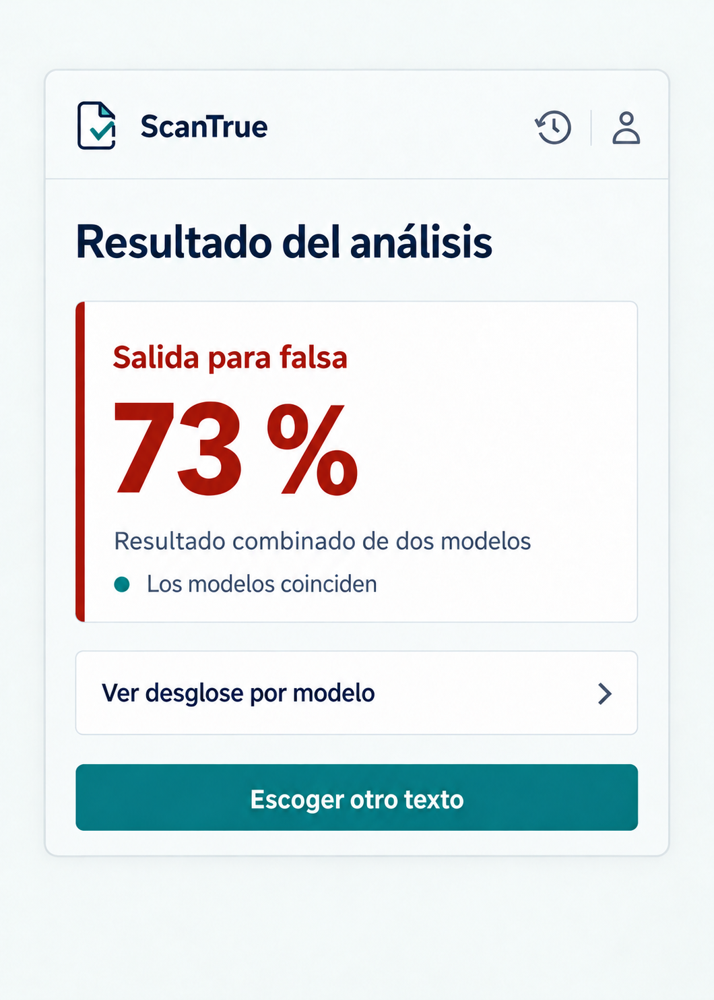

# P05 Resultado del análisis

## Estado de este archivo

Pantalla implementada en el popup según esta planificación. La imagen siguiente usa **73 %** solo para mostrar la composición; la pantalla real utiliza los valores recibidos.

**Cambio posterior implementado:** `FEATURE_P05_INDICADOR_CINCO_NIVELES_PLAN.md` define el indicador circular y los cinco niveles que ahora se muestran en P05. Las reglas anteriores sobre el panel quedan sustituidas por ese feature.

## Objetivo de P05

Presentar de forma clara el resultado unificado mediante un indicador circular y una etiqueta de nivel. Facilitar el acceso al desglose por modelo.

## Datos que recibe

| Dato de la respuesta | Uso en P05 |
| --- | --- |
| `resultado_unificado.probabilidad_falsa` | Porcentaje del anillo y nivel visible. |
| `resultado_unificado.modelos_utilizados` | Conservar para otras vistas; no se muestra en P05. |
| `comparacion` | Dato conservado de la API; no se muestra en P05 ni P06. |
| `resultados` | Conservarlos para abrir P06; los valores individuales se detallan allí. |

El porcentaje es la probabilidad recibida multiplicada por 100 y redondeada. El entero visible determina uno de cinco niveles definidos en el plan del feature. P05 no calcula pesos ni un resultado unificado propio.

## Contenido y jerarquía

1. Cabecera común de ScanTrue con accesos a Historial y Cuenta.
2. Flecha **Volver al inicio** a la izquierda del título **Resultado del análisis**.
3. Un solo panel destacado: anillo con porcentaje, etiqueta del nivel e icono correspondiente debajo de la etiqueta. No se muestran frases sobre modelos o su comparación.
4. Acceso **Ver desglose por modelo** que abre P06.
5. Acción principal **Escoger otro texto** para volver al inicio del flujo de selección.

La composición debe seguir siendo legible en el popup. Si la altura visible no alcanza, el contenido se desplaza sin ocultar el resultado ni las acciones.

## Acciones y navegación

| Acción | Resultado |
| --- | --- |
| Flecha **Volver al inicio** | Regresar a P01 sin borrar el resultado guardado. |
| **Ver desglose por modelo** | Abrir P06 dentro del popup con BiLSTM, mBERT y los datos disponibles de cada uno. |
| **Historial** | Abrir P07 dentro del popup. |
| **Cuenta** | Abrir P11 dentro del popup. |
| **Escoger otro texto** | Volver a P01 e iniciar una nueva selección. No repetir el análisis anterior. |

## Variantes y estados

| Situación | Presentación |
| --- | --- |
| Responden ambos modelos | Mostrar el porcentaje unificado con su nivel. P06 presenta el detalle por modelo. |
| Responde un modelo | Mostrar el porcentaje unificado recibido con su nivel. En P06, el otro aparece como **No disponible**. |
| Los modelos discrepan | Mantener visible el unificado; no mostrar un aviso de comparación en P05 ni P06. |
| Falta un valor unificado válido | Mostrar **Resultado unificado no disponible** y ofrecer P06 cuando haya salidas individuales. No calcular un reemplazo en el frontend. |

P04 retiene los fallos de solicitud y tiempos de espera sin respuesta concluyente. P05 solo se abre con una respuesta de análisis confirmada; no muestra un éxito ficticio tras un timeout o fallo de guardado.

## Aplicación del sistema de diseño

- Usar la cabecera, paleta, tipografía, espaciado y foco de `SISTEMA_DISENO.md`.
- El porcentaje es el único elemento numérico grande. El anillo, la etiqueta y el icono comunican juntos uno de cinco niveles de salida para falsa.
- Usar una fila de navegación sencilla para P06, sin convertir cada dato en una tarjeta decorativa.
- Escribir las etiquetas probabilísticas del feature en lenguaje directo; no presentarlas como verificación factual.
- El color no comunica por sí solo el nivel: acompañarlo de etiqueta e icono.
- No mostrar datos de blockchain ni una nota adicional bajo el desglose.

## Implementación

1. Crear la vista React de P05 con el panel del unificado, las filas de navegación y la acción para escoger otro texto.
2. Adaptar la respuesta real de la API al formato visual sin recalcular el unificado. Asignar el nivel visual al porcentaje redondeado.
3. Resolver las variantes de uno o dos modelos y la ausencia de unificado.
4. Conectar P06, P07, P11 y el regreso a P01 dentro del popup.
5. Revisar contraste, cifras, texto largo y desplazamiento en el tamaño real del popup.

Los puntos 1 a 4 y el indicador de cinco niveles están implementados. La revisión visual en Chrome con una respuesta real sigue pendiente.

## Criterios de aceptación de P05

- El porcentaje principal coincide con `resultado_unificado.probabilidad_falsa` recibido, transformado solo para mostrarlo como porcentaje.
- La vista muestra uno de cinco niveles con su color e icono, según el porcentaje unificado visible.
- P05 no muestra la cantidad de modelos ni la comparación entre ellos; P06 muestra las salidas individuales y una nota sobre sus límites.
- P06 muestra el detalle por modelo; P05 no necesita duplicar todos sus datos.
- No aparece el estado del registro de blockchain ni un acceso a su verificación.
- No aparecen porcentajes de ejemplo ni lenguaje de certeza en la pantalla real. Los niveles visibles siguen la regla documentada del feature.
- Todo permanece dentro del popup y sigue `SISTEMA_DISENO.md`.

## Dependencias y siguiente pantalla

El backend debe confirmar los campos actuales de resultado unificado, modelos participantes y comparación. Esas confirmaciones están en `DEPENDENCIAS_BACKEND.md`. P06 detallará los modelos y se planificará en su propio archivo cuando el usuario indique continuar.
