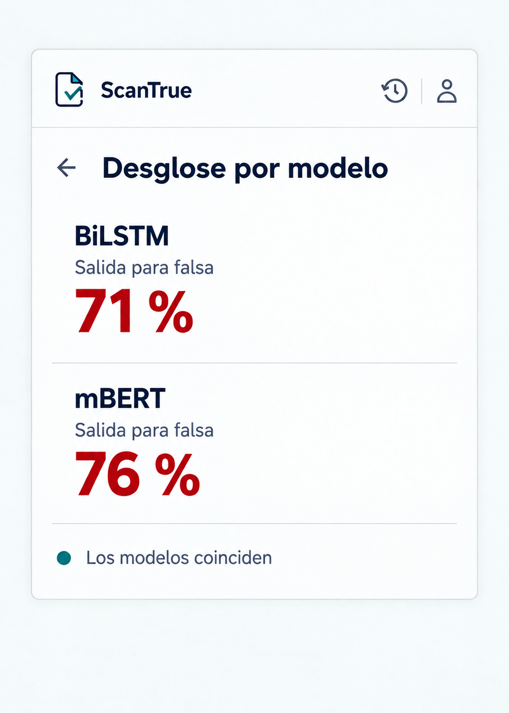

# P06 Desglose por modelo

## Estado de este archivo

Pantalla implementada para **Ver desglose por modelo** desde P05. P06 es una vista interna del popup y sigue `SISTEMA_DISENO.md`. La imagen usa porcentajes ilustrativos para mostrar la composición; la pantalla real muestra únicamente los valores recibidos de la API.

## Objetivo de P06

Permitir comparar las salidas individuales de BiLSTM y mBERT del análisis abierto. Cada modelo ocupa una sección breve y muestra su porcentaje solo si produjo una predicción válida. El usuario puede volver al resultado unificado sin iniciar otro análisis.

## Datos que recibe

| Dato de la respuesta | Uso en P06 |
| --- | --- |
| `resultados.bilstm.estado` y `resultados.mbert.estado` | Determinar si cada modelo tiene una predicción disponible. En el historial puede faltar por completo un modelo. |
| `resultados.*.probabilidad_falsa` | Mostrar **Salida para falsa** como porcentaje individual solo cuando el estado sea `ok` y el valor sea válido. |
| `comparacion` | Mostrar **Los modelos coinciden** o **Los modelos discrepan** únicamente cuando ambos respondieron y la API entregue una de esas opciones. |

El frontend transforma cada probabilidad de 0 a 1 en un porcentaje para mostrarlo, con el mismo redondeo que P05. No calcula el resultado unificado, pesos, clases propias ni una comparación entre modelos. Los campos exactos se confirmarán con la API antes de integrar esta pantalla.

## Contenido y jerarquía

1. Cabecera común de ScanTrue con accesos a Historial y Cuenta.
2. Acción **Volver** junto al título **Desglose por modelo**.
3. Sección **BiLSTM**: nombre, etiqueta **Salida para falsa** y porcentaje recibido, o **No disponible**.
4. Sección **mBERT** con la misma estructura. Un separador fino permite comparar las dos salidas sin añadir tarjetas decorativas.
5. Línea breve de coincidencia o discrepancia cuando la API la informe y haya dos predicciones válidas.

No mostrar el porcentaje unificado de nuevo: permanece en P05. Tampoco mostrar pesos, versiones, tokens, mensajes técnicos de error ni datos de blockchain. P06 no añade una nota bajo los modelos.

## Acciones y navegación

| Acción | Resultado |
| --- | --- |
| **Volver** | Regresar a P05 con el mismo resultado, sin enviar una nueva solicitud. |
| **Historial** | Abrir P07 dentro del popup. |
| **Cuenta** | Abrir P11 dentro del popup. |

Si se abre el desglose desde P08, **Volver** regresará al detalle del análisis anterior.

## Variantes y estados

| Situación | Presentación |
| --- | --- |
| Ambos modelos disponibles | Mostrar dos porcentajes individuales y la comparación, si la API la proporciona. |
| Un modelo no disponible o ausente | Mostrar su nombre y **No disponible** en lugar de un porcentaje; conservar visible la salida válida del otro. Omitir la comparación. |
| Ningún modelo disponible | Mostrar **No hay resultados por modelo disponibles** y permitir volver. No fabricar porcentajes. |
| Comparación `discrepan` | Mostrar **Los modelos discrepan** como información, sin tratarlo como un error. |
| Comparación ausente o `no_disponible` | Omitir la línea de comparación. |
| Porcentaje ausente, no numérico o fuera de 0 a 1 | Tratar ese modelo como **No disponible**. No mostrar 0 % como sustituto. |

P06 reutiliza la respuesta que ya recibió P05. Si el popup se cierra y ese resultado deja de estar disponible, el recorrido de recuperación se resolverá con el estado conservado o el historial durante la implementación; no se volverá a enviar el texto para analizarlo.

## Aplicación del sistema de diseño

- Usar la cabecera, IBM Plex Sans propuesta, paleta, espaciado y foco de `SISTEMA_DISENO.md`.
- Presentar los dos modelos en una columna, alineados a la izquierda, con igual jerarquía y separados por una línea discreta.
- Mantener los porcentajes menos dominantes que el valor unificado de P05. El nombre del modelo y **Salida para falsa** siempre acompañan la cifra.
- Mostrar **No disponible** con texto legible y color neutro, sin representar la ausencia como 0 %.
- Usar texto además de color para expresar coincidencia o discrepancia.
- Mantener todo dentro del popup; permitir desplazamiento vertical si el tamaño visible lo exige.

## Implementación

1. Crear la vista React de P06 con una sección reutilizable para cada modelo y el enlace de regreso.
2. Adaptar la respuesta real de la API sin calcular valores nuevos: validar estado y probabilidad antes de presentar cada porcentaje.
3. Resolver los casos de uno, dos o ningún modelo disponible, y la comparación informada por la API.
4. Conectar **Volver**, Historial y Cuenta con la navegación interna del popup.
5. Revisar cifras, contraste, foco de teclado y desplazamiento en el tamaño real del popup.

Los puntos 1 a 4 están implementados para los recorridos desde P05 y P08. La comprobación con una respuesta real de la API y la revisión visual en Chrome quedan pendientes.

## Criterios de aceptación de P06

- BiLSTM y mBERT aparecen identificados en el mismo orden.
- Cada porcentaje corresponde a `probabilidad_falsa` de ese modelo, transformada solo para presentación.
- Un modelo ausente, fallido o sin valor válido muestra **No disponible**, nunca 0 % inventado.
- La comparación solo aparece cuando existen dos predicciones válidas y la API la informa.
- **Volver** conserva el resultado mostrado en P05 y no repite el análisis.
- No se muestran datos técnicos secundarios ni trazabilidad blockchain.
- La vista sigue `SISTEMA_DISENO.md` y permanece dentro del popup.

## Dependencias y siguiente pantalla

El backend debe confirmar los estados y valores reales de BiLSTM y mBERT, incluidos los casos en que un modelo falla o falta en un registro histórico. Estas confirmaciones están en `DEPENDENCIAS_BACKEND.md`. La siguiente pantalla en orden es P07 Historial, que se planificará en su propio archivo cuando el usuario indique continuar.
