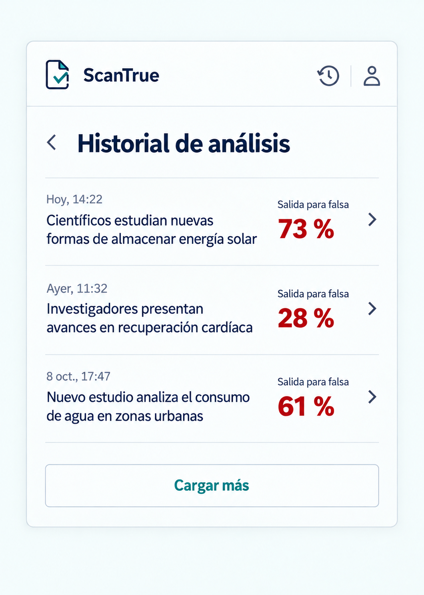

# P07 Historial de análisis

## Estado de este archivo

Pantalla implementada dentro del popup según esta planificación. P07 sigue `SISTEMA_DISENO.md` y muestra exclusivamente los análisis de la sesión activa, sea invitado o cuenta. La imagen es una referencia de composición con registros ilustrativos; la interfaz real usa el historial recibido.

## Objetivo de P07

Permitir encontrar y abrir un análisis anterior. La lista presenta fecha, una vista previa del texto cuando exista y la salida unificada guardada, con una lectura rápida y sin atribuir certeza factual al porcentaje.

## Datos que recibe

| Dato | Uso en P07 |
| --- | --- |
| `id` | Abrir el detalle P08 del registro elegido. |
| `fecha` | Mostrar fecha y hora en formato legible para el usuario. |
| `vista_previa` | Identificar el fragmento analizado; limitar su altura en la lista sin modificar el dato guardado. |
| `url` | Mostrar dominio como referencia secundaria si existe una URL válida. |
| `resultado_unificado.probabilidad_falsa` | Mostrar **Salida para falsa** y el porcentaje guardado cuando sea válido. |
| `limit`, `offset` y respuesta de paginación | Cargar más registros sin duplicar los ya visibles. |

No construir un titular a partir del fragmento ni recalcular resultados. El contrato de paginación y los campos disponibles deben confirmarse con la API vigente.

## Contenido y jerarquía

1. Cabecera común y acción **Volver**.
2. Título **Historial de análisis**.
3. Lista ordenada de más reciente a más antiguo. Cada fila muestra fecha, hasta unas líneas de vista previa y, si existe, la salida unificada con su etiqueta.
4. Acción **Cargar más** solo cuando haya más registros.

La fila completa abre P08. No incluir un botón de eliminación general ni controles de borrado en cada fila; la eliminación pertenece al detalle del registro elegido.

## Acciones y navegación

| Acción | Resultado |
| --- | --- |
| **Volver** | Regresar a la vista desde la que se abrió el historial. |
| Seleccionar una fila | Abrir P08 con el `id` de ese análisis. |
| **Cargar más** | Solicitar el siguiente tramo y añadirlo sin alterar los ya mostrados. |
| **Escoger texto** en estado vacío | Regresar a P01 e iniciar el recorrido de selección. |

## Variantes y estados

| Situación | Presentación |
| --- | --- |
| Historial vacío | **Aún no hay análisis** y una acción **Escoger texto**. |
| Carga inicial | Indicar **Cargando historial** sin simular registros definitivos. |
| Error de carga | Mantener la vista y ofrecer **Intentar de nuevo**. |
| Error al cargar más | Conservar las filas existentes y ofrecer reintento junto al final de la lista. |
| Registro sin `vista_previa` | Identificarlo por dominio y fecha; si tampoco hay dominio, usar **Análisis anterior** con su fecha. |
| Resultado unificado ausente | Mostrar **Resultado no disponible**, sin porcentaje de sustitución. |
| Sesión vencida | Intentar la renovación acordada; si falla, orientar al acceso sin borrar una sesión invitada recuperable. |

Si se elimina un registro desde P08, al regresar P07 actualiza la lista y retira solo el elemento confirmado como eliminado.

## Aplicación del sistema de diseño

- Usar la cabecera, tipografía, paleta, bordes y foco de `SISTEMA_DISENO.md`.
- Filas compactas, con separadores suaves y texto alineado a la izquierda. La vista previa es el dato principal; fecha y porcentaje ocupan una segunda jerarquía.
- Truncar la vista previa solo en la lista; P08 permite leer el texto completo.
- Mantener el área de la fila accesible con teclado y nombre descriptivo.
- Desplazar la lista dentro del popup sin perder el acceso a **Volver**.
- No usar insignias **Falsa** o **Verídica** como veredictos ni mostrar datos de blockchain.

## Implementación

1. Crear la vista React de lista y los estados de carga, vacío y error.
2. Integrar la consulta del historial propio con la sesión activa y paginación confirmada.
3. Formatear fecha y porcentaje guardados sin recalcular el análisis.
4. Conectar cada fila con P08 y actualizar la lista tras una eliminación confirmada.
5. Revisar textos largos, muchos registros, desplazamiento y navegación por teclado en el tamaño real del popup.

La lista, sus estados, la consulta con sesión activa, el formato de filas y la navegación a P08 están implementados. P08 consulta el detalle guardado y, tras una eliminación confirmada, P07 retira la fila correspondiente. La forma exacta de la respuesta paginada y la revisión visual en Chrome quedan pendientes de confirmación.

## Criterios de aceptación de P07

- Solo aparecen análisis accesibles a la sesión activa.
- Las filas abren el detalle correcto y conservan el orden recibido de más reciente a más antiguo.
- La vista maneja campos ausentes sin inventar titulares ni porcentajes.
- **Cargar más** no repite filas y un fallo no elimina los resultados ya visibles.
- La eliminación se confirma en P08, no mediante un control ambiguo en la lista.
- La vista permanece dentro del popup y sigue `SISTEMA_DISENO.md`.

## Dependencias y siguiente pantalla

El backend debe confirmar la forma de las filas, el orden y la paginación del historial. Las preguntas están en `DEPENDENCIAS_BACKEND.md`. P08 detallará un registro seleccionado.
