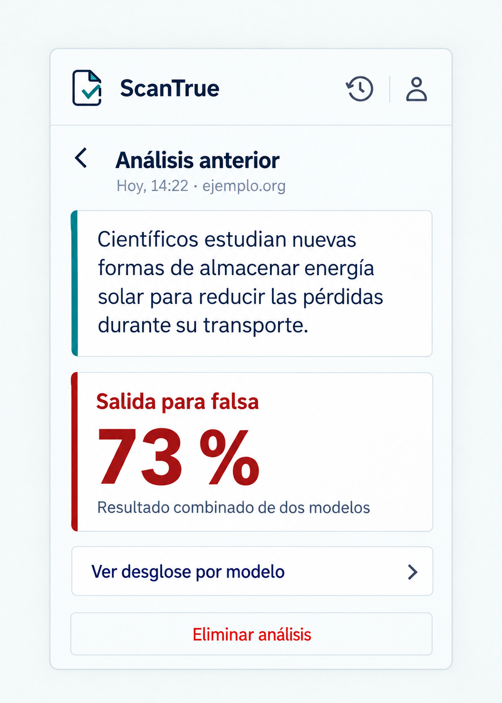

# P08 Detalle de un análisis anterior

## Estado de este archivo

Pantalla implementada para abrir un elemento de P07 dentro del popup. P08 muestra los datos guardados de ese análisis y aplica `SISTEMA_DISENO.md`. La imagen usa contenido ilustrativo; la interfaz real utiliza únicamente los datos recibidos.

La actualización visual del resultado unificado para igualarlo a P05 está implementada según `FEATURE_P08_RESULTADO_COMO_P05_PLAN.md`. Para ese panel prevalece el plan del feature sobre las descripciones anteriores de este archivo.

## Objetivo de P08

Permitir releer el texto analizado y su resultado guardado, abrir el desglose por modelo y eliminar ese elemento del historial con una confirmación clara.

## Datos que recibe

| Dato | Uso en P08 |
| --- | --- |
| `id` | Consultar y, si el usuario confirma, eliminar el registro correcto. |
| `fecha`, `url` y `texto` | Mostrar cuándo se analizó, de qué página provenía si consta y el fragmento completo. |
| `resultado_unificado.probabilidad_falsa` | Presentar el porcentaje unificado guardado con el indicador visual de P05, cuando exista. |
| `resultados` | Abrir P06 con las salidas individuales guardadas; un modelo puede faltar en un registro antiguo. |

Los datos proceden del detalle almacenado, no de una nueva predicción. P08 no reconstruye el texto desde `hash_texto` ni calcula un nuevo resultado.

## Contenido y jerarquía

1. Cabecera común, acción **Volver** y título **Análisis anterior**.
2. Fecha y dominio, si están disponibles.
3. Fragmento completo en una zona de lectura con la línea lateral de selección del sistema de diseño. Si no está guardado, mostrar **Texto no disponible**.
4. Resultado unificado guardado con el anillo, porcentaje, etiqueta de nivel y carita compartidos con P05, cuando el dato sea válido.
5. Acción **Ver desglose por modelo** cuando haya datos individuales disponibles; P06 vuelve a P08 en este recorrido.
6. Acción secundaria **Eliminar análisis** al final de la vista.

El contenido largo se desplaza dentro del popup. La eliminación no se mezcla visualmente con el resultado.

## Acciones y navegación

| Acción | Resultado |
| --- | --- |
| **Volver** | Regresar a P07 en la posición de lista previa. |
| **Ver desglose por modelo** | Abrir P06 con los valores guardados y conservar P08 como origen de regreso. |
| **Eliminar análisis** | Abrir una confirmación en el popup; aún no elimina nada. |
| **Cancelar** en la confirmación | Cerrar la confirmación y mantener el registro. |
| **Eliminar** en la confirmación | Enviar una única eliminación; tras confirmación de la API, volver a P07 y actualizar la lista. |

La confirmación dirá **¿Eliminar este análisis?** y ofrecerá las acciones **Cancelar** y **Eliminar**. Si la solicitud falla, permanecer en P08 con el registro visible y ofrecer reintento.

## Variantes y estados

| Situación | Presentación |
| --- | --- |
| Detalle cargando | Indicar carga sin mostrar valores de otro análisis. |
| Registro antiguo sin texto | Mostrar **Texto no disponible** y conservar fecha y resultados presentes. |
| Modelo ausente en el historial | P06 muestra **No disponible** para ese modelo. |
| Resultado unificado ausente | Mostrar **Resultado no disponible** sin calcular uno nuevo. |
| Registro no encontrado o ajeno | Informar **Este análisis ya no está disponible** y ofrecer volver a P07. |
| Error al consultar | Conservar el identificador y ofrecer **Intentar de nuevo**. |
| Eliminación en curso | Deshabilitar la acción repetida y mantener visible la confirmación. |
| Error al eliminar | No retirar la fila del historial; mostrar el error y permitir reintentar o cancelar. |

## Aplicación del sistema de diseño

- Usar la cabecera, tipografía, paleta, espaciado y foco de `SISTEMA_DISENO.md`.
- Dar prioridad al texto seleccionado y al resultado guardado; la fecha y el dominio son secundarios.
- Reutilizar la línea lateral verde azulada del fragmento de P02 para conectar ambas vistas.
- Mostrar la acción de eliminación con tratamiento secundario y una confirmación clara, accesible con teclado.
- No mostrar estado, hash ni acciones de blockchain.

## Implementación

1. Crear la vista React con estados de carga, contenido parcial y error.
2. Consultar el detalle por `id` usando la sesión activa y presentar los valores guardados.
3. Conectar el desglose P06 con regreso a P08.
4. Añadir confirmación y eliminación con actualización de P07 solo tras éxito confirmado.
5. Revisar texto largo, registro antiguo incompleto, foco de la confirmación y desplazamiento real del popup.

Los puntos 1 a 4 están implementados. La comprobación con una respuesta real de la API y la revisión visual en Chrome quedan pendientes; los campos de registros antiguos y respuestas de eliminación requieren confirmación del backend.

## Criterios de aceptación de P08

- El texto mostrado corresponde al registro elegido o indica claramente su ausencia.
- Se muestran los resultados almacenados, sin solicitar otro análisis ni recalcular porcentajes.
- El desglose usa los datos de ese registro y vuelve a P08.
- Ninguna eliminación ocurre antes de la confirmación; un fallo conserva el registro visible.
- No aparece información de blockchain ni una afirmación de veracidad.
- Todo permanece dentro del popup y sigue `SISTEMA_DISENO.md`.

## Dependencias y siguiente pantalla

El backend debe confirmar los campos de detalle, la eliminación y los casos de registros antiguos o inexistentes. Las preguntas están en `DEPENDENCIAS_BACKEND.md`. P09 cubrirá las métricas de evaluación.
