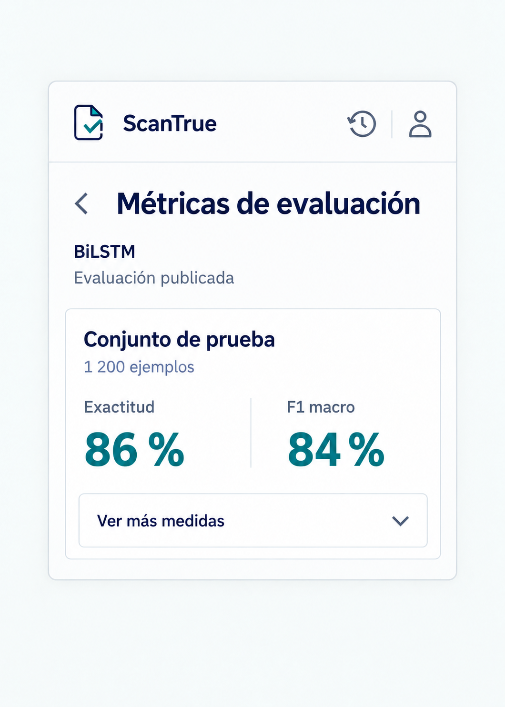

# P09 Métricas de evaluación

## Estado de este archivo

Pantalla implementada en el popup según `SISTEMA_DISENO.md`. La imagen presenta una composición con cifras ilustrativas; la pantalla real muestra exclusivamente las evaluaciones publicadas por la API.

La simplificación de textos, nombres y tamaños de P09 está implementada según `FEATURE_P09_METRICAS_SIMPLIFICADAS_PLAN.md`. Para la presentación de esa pantalla prevalece el plan del feature sobre las descripciones anteriores de este archivo.

## Objetivo de P09

Permitir consultar el rendimiento publicado de los modelos en conjuntos de evaluación. Estas cifras describen pruebas del modelo y no el análisis concreto que el usuario acaba de realizar.

## Datos que recibe

| Dato de `/metricas` | Uso en P09 |
| --- | --- |
| `modelo` | Identificar qué modelo fue evaluado; la versión no se muestra en la vista simplificada. |
| `evaluaciones[]` | Mostrar una sección por conjunto recibido, sin crear conjuntos adicionales. |
| `conjunto`, `n` y `fuente` | Identificar la prueba, el número de textos evaluados y el origen cuando existan. |
| `exactitud` | Mostrar **Aciertos en las pruebas** cuando el valor sea válido. |
| `f1_macro`, `precision_falsa`, `recall_falsa` y `f1_falsa` | Se reciben, pero no se muestran en la vista simplificada. |
| `limitaciones` | Presentar el contenido recibido en **Sobre estas pruebas**. |

Las medidas decimales de 0 a 1 se multiplican por 100 solo para presentarlas como porcentajes, con un redondeo consistente. La matriz de confusión y `orden_clases` se reservan para una decisión posterior sobre una presentación comprensible; no se mostrarán como JSON ni como tabla cruda en esta primera propuesta. Los nombres y valores finales dependen de la respuesta confirmada del backend.

## Contenido y jerarquía

1. Cabecera común, acción **Volver** y título **Pruebas del modelo**.
2. Nombre del modelo evaluado, sin versión visible.
3. Por cada conjunto: nombre, **Aciertos en las pruebas**, cantidad de textos evaluados y **Datos** de origen, solo cuando existan.
4. Apartado desplegable **Sobre estas pruebas** con las limitaciones recibidas.

No mostrar estadísticas de uso, tiempos de respuesta, conteos de análisis ni métricas de mBERT si `/metricas` solo publica BiLSTM. Evitar cifras ilustrativas en la interfaz real.

## Acciones y navegación

| Acción | Resultado |
| --- | --- |
| **Volver** | Regresar a la pantalla desde la que se abrió P09. |
| **Datos** abreviados | Desplegar el origen completo sin otra solicitud. |
| **Sobre estas pruebas** | Expandir o contraer las limitaciones recibidas. |
| **Intentar de nuevo** tras error | Volver a solicitar `/metricas`. |

## Variantes y estados

| Situación | Presentación |
| --- | --- |
| Datos disponibles | Mostrar únicamente modelos, conjuntos y medidas recibidos. |
| Más de un conjunto | Apilar secciones compactas con separadores y desplazamiento vertical. |
| Sin evaluaciones publicadas | Mostrar **Aún no hay pruebas disponibles** y permitir volver. |
| Medida ausente | Omitir esa medida; no mostrar 0 % como sustituto. |
| Limitaciones ausentes | Omitir la sección, sin redactar una limitación inventada. |
| API inaccesible o error | Mostrar mensaje breve y **Intentar de nuevo**. |

## Aplicación del sistema de diseño

- Usar la cabecera, tipografía, colores, espaciado y foco de `SISTEMA_DISENO.md`.
- Organizar los datos como una ficha de evaluación: modelo arriba, conjuntos separados y cifras alineadas para comparar.
- Mantener visibles las etiquetas de cada medida; no usar solo porcentajes grandes.
- Dar más peso al porcentaje de aciertos que al nombre y origen de la prueba.
- Permitir consultar el origen completo solo si su presentación se abrevia o resulta larga.
- Conservar el contenido dentro del popup con desplazamiento y controles accesibles por teclado.

## Implementación

1. Crear la vista React con secciones de conjunto, medidas principales y detalle desplegable.
2. Integrar `/metricas` y adaptar solamente campos presentes y válidos.
3. Resolver carga, vacío, errores y conjuntos múltiples.
4. Revisar el texto de limitaciones con la respuesta real y ajustar su presentación sin alterar el significado.
5. Probar legibilidad, contraste, expansión, foco y desplazamiento en el tamaño real del popup.

Los puntos 1 a 3 están implementados. La revisión de limitaciones con una respuesta real de la API y la comprobación visual en Chrome quedan pendientes.

## Criterios de aceptación de P09

- Cada cifra procede de `/metricas` y está asociada al modelo y conjunto correctos.
- La pantalla distingue claramente las evaluaciones publicadas del análisis de una noticia.
- Una medida o conjunto ausente no se reemplaza por datos inventados.
- Las limitaciones se muestran cuando existan.
- El detalle se expande con teclado y la vista permanece dentro del popup.
- No se muestran datos de blockchain.

## Dependencias y siguiente pantalla

El backend debe entregar un ejemplo real de `/metricas`, incluidas sus evaluaciones y limitaciones. Esta solicitud está en `DEPENDENCIAS_BACKEND.md`. P10 permanece eliminado por decisión del usuario; la siguiente pantalla a planificar de esta tanda es P11 Cuenta.
