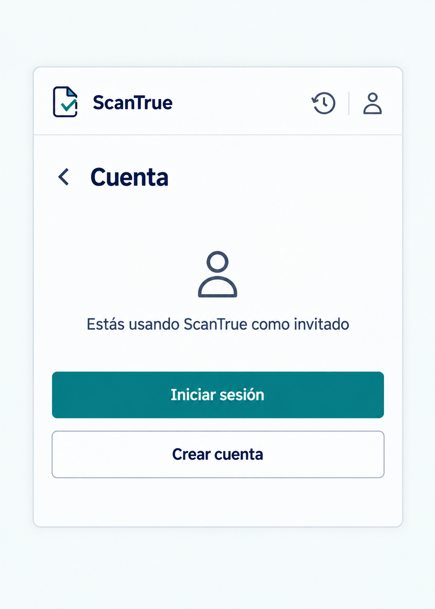

# P11 Cuenta

## Estado de este archivo

Pantalla implementada en el popup con variantes para invitado y usuario con cuenta. Sigue `SISTEMA_DISENO.md`. La imagen muestra la variante de invitado solo como referencia de composición.

## Objetivo de P11

Mostrar el estado de acceso de forma sencilla y ofrecer la acción correspondiente: entrar o crear una cuenta si el usuario es invitado; consultar su cuenta o cerrar sesión si ya inició sesión.

## Datos y estado que necesita

| Dato o estado | Uso en P11 |
| --- | --- |
| Sesión invitada o de cuenta | Elegir la variante visible sin depender solo de la existencia de un token. |
| Correo de la cuenta, si consta | Identificar la cuenta activa sin pedir datos adicionales solo para decorar la vista. |
| Confirmación pendiente, si el flujo la conserva | Orientar a revisar el correo y luego iniciar sesión, manteniendo la sesión invitada. |
| Resultado de cierre de sesión | Cambiar a estado sin cuenta solo después de recibir éxito confirmado. |

P11 no muestra tokens, identificadores internos ni detalles de autenticación.

## Contenido y jerarquía

### Variante de invitado

1. Cabecera común, acción **Volver** y título **Cuenta**.
2. Estado **Estás usando ScanTrue como invitado**.
3. Acción principal **Iniciar sesión** para abrir P13.
4. Acción secundaria **Crear cuenta** para abrir P12.

No presentar la creación de cuenta como requisito para analizar. El historial del invitado permanece accesible mientras su sesión siga disponible.

### Variante con cuenta

1. Título **Cuenta**.
2. Estado **Sesión iniciada** y correo si la sesión lo proporciona.
3. Acción **Cerrar sesión**, separada de la navegación habitual para evitar pulsaciones accidentales.

No mostrar una ficha extensa de perfil si el backend no entrega esos datos.

## Acciones y navegación

| Acción | Resultado |
| --- | --- |
| **Volver** | Regresar a la pantalla desde la que se abrió P11. |
| **Iniciar sesión** | Abrir P13 dentro del popup. |
| **Crear cuenta** | Abrir P12 dentro del popup cuando se implemente su formulario. |
| **Cerrar sesión** | Solicitar el cierre una sola vez; tras éxito, actualizar el estado local y volver a una variante sin cuenta. |

Cerrar el popup mediante el control de la cabecera no cierra sesión.

## Variantes y estados

| Situación | Presentación |
| --- | --- |
| Invitado activo | Mostrar accesos a inicio de sesión y registro. |
| Cuenta activa | Mostrar estado de sesión y acción para cerrarla. |
| Registro pendiente de confirmación | Mostrar indicación breve para revisar el correo y conservar la sesión invitada. |
| Cierre de sesión en curso | Deshabilitar otra pulsación y mostrar **Cerrando sesión**. |
| Error al cerrar | Mantener la cuenta visible y ofrecer reintento; no fingir que se cerró. |
| Sesión caducada | Intentar renovación según el flujo acordado; si falla, ofrecer iniciar sesión sin borrar datos recuperables del invitado. |

## Aplicación del sistema de diseño

- Usar cabecera, tipografía, paleta, espaciado y foco de `SISTEMA_DISENO.md`.
- Dar protagonismo al estado actual y a una acción principal clara; evitar cuadros de configuración sin función.
- Diferenciar visualmente **Iniciar sesión** y **Crear cuenta** sin hacer que ambas parezcan primarias.
- Mostrar errores junto a la acción afectada, en lenguaje cotidiano.
- Mantener todo dentro del popup y permitir desplazamiento si el mensaje de estado crece.

## Implementación

1. Crear variantes React para invitado, cuenta y confirmación pendiente.
2. Leer el estado de sesión conservado por la extensión sin exponer credenciales en pantalla ni consola.
3. Conectar P12 y P13 con navegación interna; conectar el cierre de sesión con la API.
4. Mantener el estado anterior ante errores de cierre o renovación.
5. Revisar foco, textos y transiciones de estado en el popup real.

Las variantes, lectura segura de la sesión, navegación interna y cierre confirmado están implementados. **Crear cuenta** e **Iniciar sesión** ya abren los formularios P12 y P13. El registro y el inicio de sesión aún no se conectan con el backend. La comprobación con respuestas reales de la API y la revisión visual en Chrome quedan pendientes.

## Criterios de aceptación de P11

- El estado mostrado coincide con la sesión activa.
- El invitado puede iniciar sesión o crear cuenta sin perder su historial por navegar.
- El cierre solo se refleja tras respuesta exitosa; cerrar el popup no cierra sesión.
- No se muestran tokens ni datos internos de autenticación.
- La vista sigue `SISTEMA_DISENO.md` y permanece dentro del popup.

## Dependencias y siguiente pantalla

El backend debe confirmar las respuestas de sesión y cierre, y qué datos de cuenta están disponibles. Las preguntas están en `DEPENDENCIAS_BACKEND.md`. P12 Registro y confirmación se describe en `PANTALLA_P12_REGISTRO_CONFIRMACION_PLAN.md`; su primera fase muestra únicamente el formulario.
