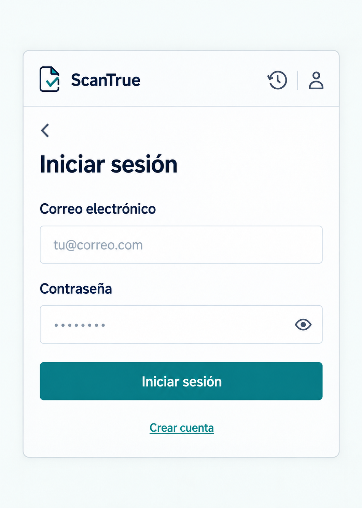

# P13 Inicio de sesión

## Estado de este archivo

La primera fase de P13 ya muestra el formulario de acceso dentro del popup, sin conectar todavía el inicio de sesión con el backend. P13 aplica `SISTEMA_DISENO.md`. La imagen es una referencia de composición, sin credenciales reales. La autenticación y la incorporación de historial quedan para una fase posterior.

## Objetivo de P13

Permitir entrar con correo y contraseña, informar errores comprensibles y confirmar el acceso sin hacer desaparecer el historial previo del invitado antes de que la API confirme la transición.

## Datos y estado que necesita

| Dato o estado | Uso en P13 |
| --- | --- |
| Correo y contraseña escritos | Enviar la solicitud de acceso cuando el usuario pulse **Iniciar sesión**. |
| Sesión invitada activa, si existe | Solicitar la incorporación del historial con el mecanismo confirmado por el backend. |
| Respuesta de sesión | Sustituir la sesión local solo tras acceso exitoso. |
| `registros_incorporados`, si existe | Mostrar cuántos análisis se incorporaron, sin inventar una cifra. |
| Error de acceso o confirmación pendiente | Mostrar la corrección o siguiente paso sin borrar la sesión invitada. |

En la primera fase el formulario no envía datos: **Iniciar sesión** está deshabilitado con una explicación visible. Los datos de la tabla se necesitarán cuando se integre el backend.

## Contenido y jerarquía

1. Cabecera común, acción **Volver** y título **Iniciar sesión**.
2. Campo **Correo electrónico** con etiqueta visible.
3. Campo **Contraseña** con etiqueta visible y opción accesible de mostrar u ocultar el texto.
4. Mensaje de error junto al campo o formulario afectado, cuando corresponda.
5. Acción **Iniciar sesión** deshabilitada por ahora, con el aviso **El inicio de sesión aún no está disponible**.
6. Acceso secundario **Crear cuenta** que abre P12.

Tras un acceso correcto, volver a P11 o a la vista de origen según el recorrido, y mostrar de forma breve la incorporación del historial solo si la API la confirma.

## Acciones y navegación

| Acción | Resultado |
| --- | --- |
| **Volver** | Regresar a P11 sin modificar la sesión invitada. |
| **Iniciar sesión** | En la primera fase no envía datos. En la integración posterior enviará una sola solicitud y bloqueará envíos repetidos mientras espera. |
| Mostrar u ocultar contraseña | Cambiar solo la visibilidad del campo, sin modificar su valor. |
| **Crear cuenta** | Abrir P12 dentro del popup. |

Si no existe una sesión invitada con historial, iniciar sesión no promete incorporación de registros.

## Variantes y estados

| Situación | Presentación |
| --- | --- |
| Formulario inicial | Campos vacíos, etiquetas visibles y acción deshabilitada con explicación hasta la integración. |
| Campos incompletos o correo mal formado | Mensaje breve junto al campo; conservar lo escrito. |
| Envío en curso | Estado futuro: mostrar **Iniciando sesión** y evitar doble envío. |
| Credenciales incorrectas | Estado futuro: mostrar **Revisa el correo y la contraseña**; conservar el correo y permitir corregir la contraseña. |
| Cuenta pendiente de confirmación | Estado futuro: indicar que debe confirmar el correo antes de entrar; mantener la sesión invitada. |
| Servicio inaccesible | Estado futuro: mantener el formulario y ofrecer reintento. |
| Acceso exitoso con incorporación confirmada | Estado futuro: actualizar la sesión y, si llega un recuento, informar los análisis incorporados. |
| Incorporación no confirmada o error | Estado futuro: no afirmar que el historial se transfirió; preservar la sesión invitada recuperable hasta resolver el estado real. |

## Aplicación del sistema de diseño

- Usar cabecera, tipografía, paleta, campos, botones y foco de `SISTEMA_DISENO.md`.
- Una sola columna, etiquetas persistentes y error cerca del campo correspondiente.
- Dejar **Iniciar sesión** como única acción sólida; **Crear cuenta** es secundaria.
- Evitar explicaciones técnicas sobre tokens o mecanismos de incorporación en la interfaz.
- Mantener el formulario usable con teclado y dentro del alto desplazable del popup.

## Implementación por fases

1. **Implementado:** vista React con correo, contraseña, visibilidad, validación local, navegación hacia P11/P12 y aviso de indisponibilidad. No se guardan las credenciales ni se envía una solicitud.
2. **Pendiente:** confirmar el contrato con el backend e integrar la solicitud de acceso y la incorporación del historial invitado.
3. **Pendiente:** cambiar la sesión almacenada solo después de una respuesta exitosa y verificar el recuento antes de mostrarlo.
4. **Pendiente:** resolver credenciales incorrectas, confirmación pendiente, servicio inaccesible y fallos de incorporación sin borrar la sesión invitada recuperable.
5. **Pendiente:** comprobar los recorridos integrados en Chrome con respuestas reales de la API.

Al salir de P13 se descartan los valores escritos. La revisión visual del popup en Chrome queda pendiente.

## Criterios de aceptación de la primera fase

- El formulario de correo y contraseña se abre desde P11 y permite ir a P12 sin salir del popup.
- Los errores locales permiten corregir los campos mientras el usuario permanece en P13.
- **Iniciar sesión** informa que aún no está disponible; no envía solicitudes, no crea una sesión aparente ni afirma haber incorporado historial.
- No se muestran ni registran contraseñas o tokens.
- **Volver** y **Crear cuenta** navegan dentro del popup.
- La vista sigue `SISTEMA_DISENO.md`.

## Dependencias

El backend debe confirmar el contrato de inicio de sesión, confirmación de correo e incorporación de historial invitado antes de habilitar el envío. Las preguntas están en `DEPENDENCIAS_BACKEND.md`. P12 se describe en `PANTALLA_P12_REGISTRO_CONFIRMACION_PLAN.md`; ambos formularios se muestran sin conectar todavía el registro ni el inicio de sesión con la API.
